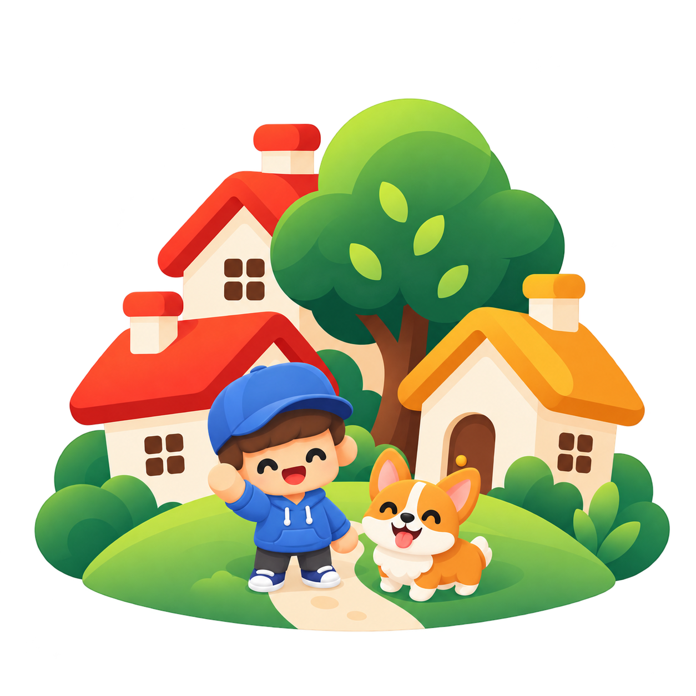

# Town of Me



Town of Me is a portfolio presented as a small 3D town in the browser. Instead of reading a profile, visitors walk
around, meet residents who worked with the owner and hear what they say about them, pet the owner's dog, and leave a
note in the guestbook. The owner arranges the whole town in a built-in editor.

## Features

- **The town:** keyboard and touch movement with a soft-follow camera, an Animal Crossing–style skid when turning at a
  run, local-time lighting, music, and ambient sound, seasons that change in order (leaves fall before the snow), and a
  corgi to pet.
- **Residents:** each one introduces themselves and answers "What kind of person is the owner?" with lines prepared from
  their written reference. An admin drafts them with an LLM (OpenRouter) and reviews every line before visitors hear
  it.
- **The owner:** an optional introduction before visitors make their character, and a button to reach the owner by
  email.
- **Guestbook:** anyone can write; notes appear after an admin approves them.
- **Ballpark:** once an admin shows it, a garden ballpark's gate opens at the town's north edge onto `/baseball`, a
  home-run derby swung with the webcam, which never leaves the browser.
- **Editor at `/admin`:** place, move, recolor, and remove every house, tree, road, and bench; register residents;
  edit the owner's introduction and the pet's walk; choose how everyone walks; moderate the guestbook; and manage who
  else may edit. Routes that cut through houses or trees are flagged. Admins sign in with LinkedIn.
- **Korean and English** throughout, reduced-motion support, and a fallback when WebGL is unavailable.

## Run it

Requirements: Node.js 26 or newer.

```sh
npm install
npm run dev
```

The frontend runs at <http://localhost:5173> and the backend at <http://localhost:3000>. Without `DATABASE_URL`, the
backend keeps data in memory and starts from a fictional sample town on every restart. To keep data, start PostgreSQL
and set `DATABASE_URL` in `.env` as shown in [`.env.example`](.env.example):

```sh
docker compose up -d postgres
```

`npm run check` runs every module's lint, format, test, and build. `docker compose up --build` builds and starts the
whole stack in containers ([docker/README.md](docker/README.md)).

## Make it your own

1. Copy `.env.example` to `.env`. Set `ADMIN_EMAILS` to the email of the LinkedIn account you will sign in with, and
   add your LinkedIn app's keys (and optionally an OpenRouter key) as described in [backend/README.md](backend/README.md).
2. Start the app. The backend creates the town from [`backend/seed/town.json`](backend/seed/town.json), a fictional
   town owned by Robin. To start from your own town instead, point `TOWN_SEED_PATH` at a private copy (for example
   `.seed/town.json`, which git ignores) before the first start.
3. Sign in at `/admin` and make it yours: the owner's and the pet's names, the houses, and the residents and their
   references. Add other admins from the editor's `Admins` panel.

The seed is used only while the database has no town, so later edits are never overwritten. Nothing personal needs to
live in the code.

## Documentation

- [ARCHITECTURE.md](ARCHITECTURE.md): how the code is organized, where data lives, and how to extend it.
- [CONTRIBUTING.md](CONTRIBUTING.md): setup, checks, and the rules for changes. [AGENTS.md](AGENTS.md) holds the same
  rules for coding agents, and [`skills/`](skills/) has review and security-check instructions for them.
- [frontend/README.md](frontend/README.md): what visitors and admins can do, controls, audio, and the camera.
- [backend/README.md](backend/README.md): the API, sign-in and security boundaries, the guestbook, and data.
- [TODO.md](TODO.md): open work.

## Status

The project runs locally and in containers but has not been deployed. LinkedIn sign-in and OpenRouter drafts are
implemented and need end-to-end tests against the live services. Visitors never sign in; their characters stay in the
browser tab.

## License

Town of Me is source-available under the [PolyForm Noncommercial License 1.0.0](LICENSE.md): anyone may use, change,
and share it for noncommercial purposes, and commercial use needs separate permission. It is not an OSI-approved open
source license. Bundled third-party assets keep their own licenses (the Kenney Nature Kit and the bark recording are
CC0); [`frontend/public/assets/CREDITS.md`](frontend/public/assets/CREDITS.md) lists each one with its author and
source.
